# Exchange : déploiement et administration d'un serveur Exchange 2019

Le but est de monter un environnement Exchange complet et fonctionnel, de l'installation des prérequis jusqu'à la surveillance des services en production, en passant par la préparation d'Active Directory, la création de bases de données, de boîtes aux lettres, de groupes de distribution et de salles de réunion.

Le scénario impose une entreprise fictive avec un domaine local et un serveur `EXCHANGE01` joint à ce domaine. Chaque étape ci-dessous reprend les commandes PowerShell utilisées, une explication de ce qu'elles font et de leurs paramètres, et une capture d'écran du résultat obtenu.

**Stack** : Windows Server · Active Directory · Exchange Server 2019 · PowerShell · IIS · Outlook / OWA

## Sommaire

1. Configuration des prérequis
2. Préparation de l'Active Directory
3. Installation d'Exchange
4. Configuration des bases de données
5. Création de boîtes aux lettres
6. Gestion des groupes de distribution
7. Création de salles de réunion
8. Configuration Outlook
9. Accès web (OWA)
10. Surveillance des services

---

# 1- Configuration des Prérequis

On renomme le serveur pour ne pas garder le nom générique WIN-*****

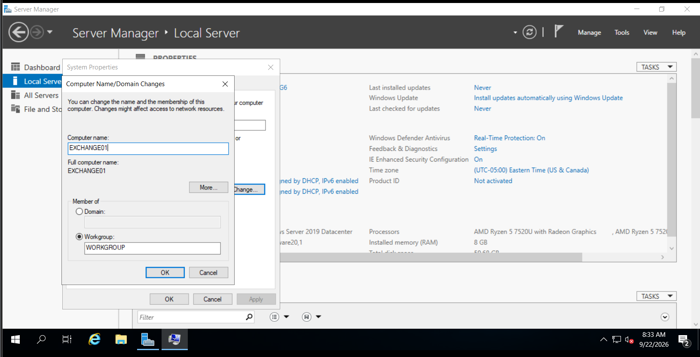

On télécharge les logiciels et programmes requis

<aside>

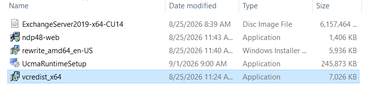

**`vcredist_x64`** : **Visual C++ Redistributable Package (x64)**. composants Visual C++ requis 
**`ndp48-web`** : **Microsoft .NET Framework 4.8** . C'est le fichier d'installation de .NET 4.8 
**`UcmaRuntimeSetup`** : **Microsoft Unified Communications Managed API 4.0 (UCMA 4.0) Runtime**. C'est un prérequis applicatif indispensable pour Exchange Server 2019
**`rewrite_amd64_en-US`** : **IIS URL Rewrite Module 2.1**. C'est un composant requis par Exchange pour la gestion des redirections web sous IIS  

</aside>

## Installer les roles Windows nécessaires via Powershell

```powershell
Add-WindowsFeature rsat-adds-tools
```

Avec cette commande on installe les outils d'administration d'Active Directory (cmdlets PowerShell AD, console "Utilisateurs et ordinateurs AD", etc.) pour pouvoir gérer/interroger l'AD directement depuis EXCHANGE01

```powershell
Install-WindowsFeature RPC-over-HTTP-proxy, RSAT-Clustering, RSAT-Clustering-CmdInterface, RSAT-Clustering-Mgmt,RSAT-Clustering-PowerShell, Web-Mgmt-Console, WAS-Process-Model, Web-Asp-Net45, Web-Basic-Auth, Web-Client-Auth, Web-Digest-Auth, Web-Dir-Browsing, Web-Dyn-Compression, Web-Http-Errors,Web-Http-Logging, Web-Http-Redirect, Web-Http-Tracing, Web-ISAPI-Ext, Web-ISAPI-Filter, Web-Lgcy-Mgmt-Console, Web-Metabase, Web-Mgmt-Console, Web-Mgmt-Service, Web-Net-Ext45, Web-Request-Monitor, Web-Server, Web-Stat-Compression, Web-Static-Content,Web-Windows-Auth, Web-WMI, Windows-Identity-Foundation, NET-WCF-HTTP-Activation45
```

Cette commande installe tous les rôles et fonctionnalités Windows requis comme prérequis officiels pour Exchange Server:

- **IIS et ses sous-composants** (`Web-Server`, `Web-Asp-Net45`, `Web-Basic-Auth`, `Web-Digest-Auth`, `Web-ISAPI-Ext`, etc.): Exchange s'appuie entièrement sur IIS pour OWA, ECP, EWS, ActiveSync, MAPI/HTTP.
- **RPC-over-HTTP-proxy** : nécessaire pour la façon dont Outlook se connecte au serveur
- **RSAT-Clustering :** outils de basculement (Windows Failover Clustering), requis même en environnement mono-serveur car Exchange les utilise pour la gestion des Database Availability Groups.
- **NET-WCF-HTTP-Activation45** et **Windows-Identity-Foundation** : composants .NET nécessaires au fonctionnement interne d'Exchange.

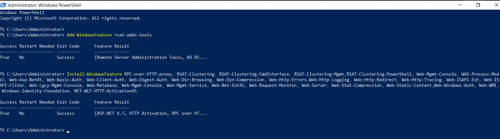

## Configurer le .NET Framework 4.8.

Avant l’installation

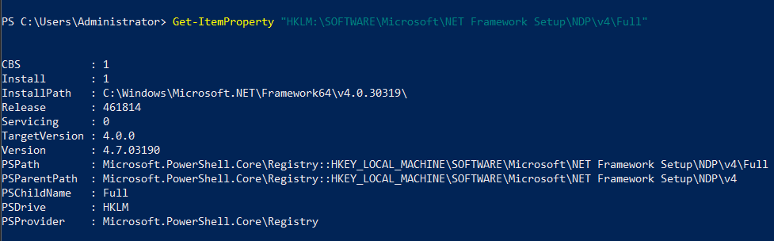

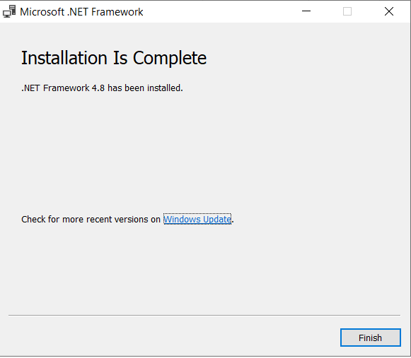

Après l’installation : Nouvelle version 

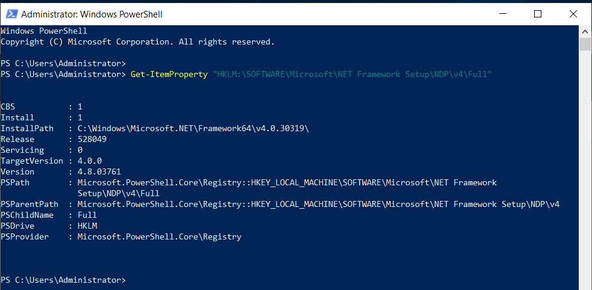

## Installer les composants Visual C++ requis.

On l'installe parce qu'Exchange n'est pas écrit entièrement en .NET managé. Son moteur de stockage et pas mal de DLL internes tournent en code natif C++. Sans les bonnes bibliothèques d'exécution Visual C++, l'installateur bloque à la vérification des prérequis, ou pire, certains services démarrent puis plantent avec une DLL manquante.

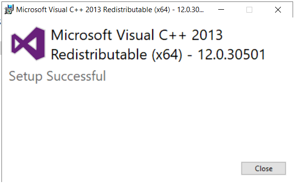

## Configurer les services Windows requis.

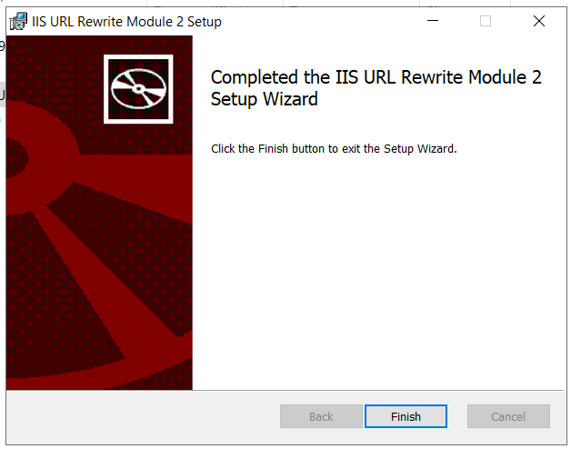

Nécessaire pour la fonctionnalité "Hybrid" et surtout pour le bon fonctionnement du proxying interne d'Exchange à travers IIS (redirections entre le rôle Frontend Transport et les backends). Sans lui, l'installateur d'Exchange le réclame explicitement au lancement du setup.

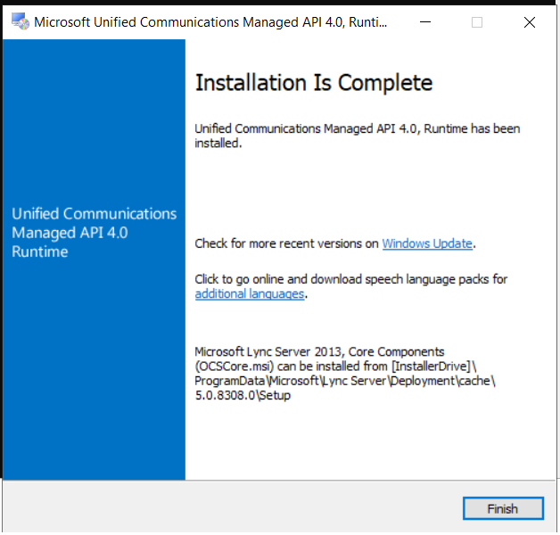

Requis pour Unified Messaging (messagerie unifiée, intégration avec Skype/Lync) et pour certains composants de traitement audio/vidéo qu'Exchange embarque.

Exchange nécessite que le service d'administration IIS soit en démarrage automatique :

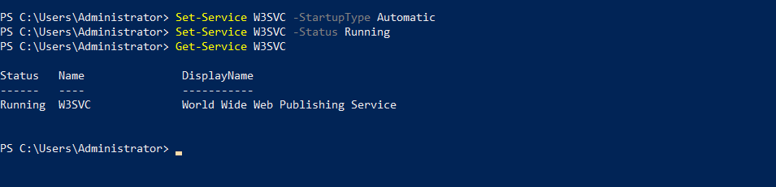

# 2- Préparation de l'Active Directory

## Configuration du domaine

J’ai renommé la machine en DC01 - j’ai installé le roles ADDS et j’ai promu en controleur de domaine

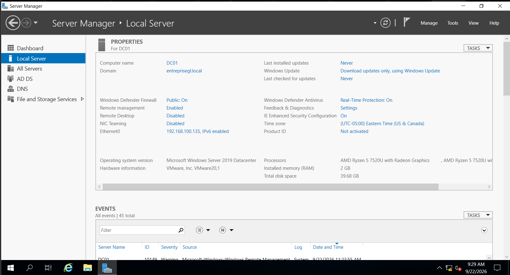

## Jonction de `ECHANGE01` au domaine

On s’assure que le DNS de la carte LAN de la machine pointe vers l’IP du DC01 sinon la jonction échouera


## Préparer le schéma Active Directory

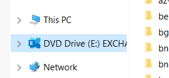

```powershell
E:\Setup.exe /PrepareSchema /IAcceptExchangeServerLicenseTerms_DiagnosticDataOff
```

- `/PrepareSchema` : Connecte le serveur au maître de schéma AD et importe les définitions d'attributs/classes nécessaires à Exchange.
- `/IAcceptExchangeServerLicenseTerms` : Accepte les conditions de licence Microsoft requises pour l'exécution sans interface graphique.
- **`_DiagnosticDataOFF`** :  **désactive** la collecte et l'envoi de ces données de télémétrie à Microsoft.

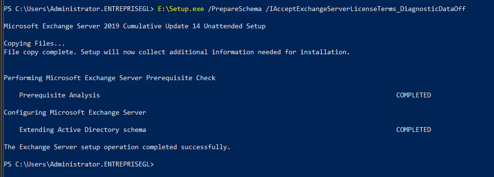

## Préparer le domaine Active Directory

```powershell
E:\Setup.exe /PrepareAD /OrganizationName:"ENTREPRISEGL" /IAcceptExchangeServerLicenseTerms_DiagnosticDataOff
```

- `/PrepareAD` : Prépare la forêt et le domaine AD racine, crée les groupes de sécurité de rôles d'accès et la hiérarchie de configuration Exchange.
- `/OrganizationName:"ENTREPRISEGL"` : Définit le nom de l'organisation Exchange.

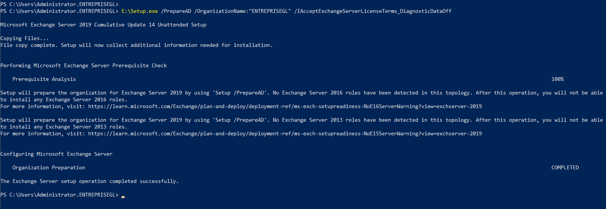

## Vérifier la préparation d'AD

L'UO est présente et contient les groupes de sécurité Exchange (*Organization Management*, *Exchange Servers*, etc.).

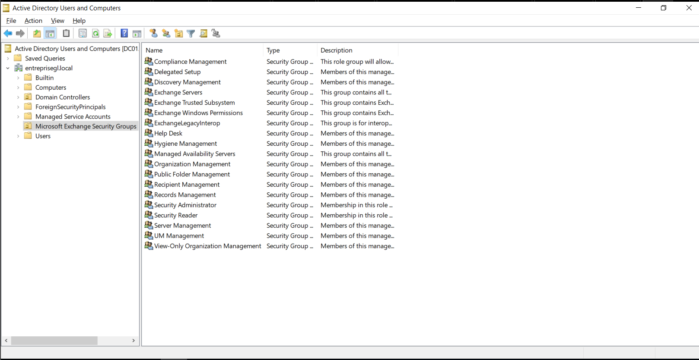

# 3- Installation d'Exchange

## Lancer l'installation en mode ligne de commande

```powershell
E:\Setup.exe /Mode:Install /Role:Mailbox /IAcceptExchangeServerLicenseTerms_DiagnosticDataOff
```

- **`/Mode:Install`** : Spécifie que l'on effectue une nouvelle installation des composants serveur.
- **`/Role:Mailbox`** : Installe le rôle de boîte aux lettres (qui gère le stockage des bases de données, le routage des messages et les services d'accès client OWA/ECP/ActiveSync)

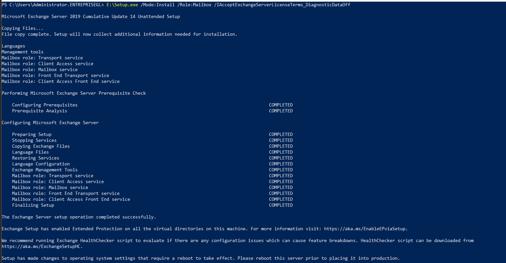

## Configurer l'espace d'adressage

Puisque le domaine Active Directory a été préparé sous `entreprisegl.local`, ce domaine est déjà créé comme domaine accepté par défaut. Pour le vérifier  dans la console Exchange Management Shell, on utilise la commande :

```
Get-AcceptedDomain
```

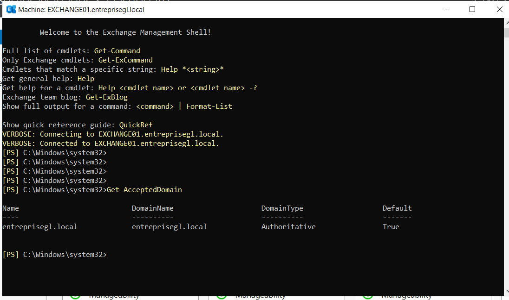

## Vérification des fichiers journaux

Le dossier **`C:\ExchangeSetupLogs`** contient l'historique complet des actions effectuées par l'installateur.

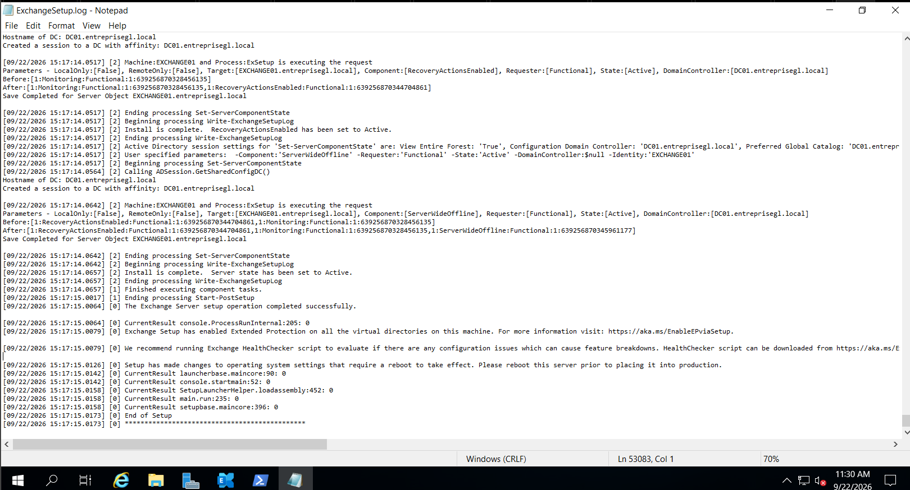

```powershell
[09/22/2026 15:17:14.0657] [2] Install is complete.  Server state has been set to Active.
[09/22/2026 15:17:15.0064] [0] The Exchange Server setup operation completed successfully.
```

# 4- Configuration des Bases de Données

## Créer une base de données de boîtes aux lettres nommée "DB_ETUDIANTS" et Configurer le chemin de la base

```powershell
New-MailboxDatabase -Name "DB_ETUDIANTS" -Server $env:COMPUTERNAME -EdbFilePath "E:\ExchangeDB\DB_ETUDIANTS\DB_ETUDIANTS.edb" -LogFolderPath "E:\ExchangeDB\DB_ETUDIANTS\Logs”
```

• **`-Name "DB_ETUDIANTS"`** : Nom de la nouvelle base de données de boîtes aux lettres dans Exchange.  • **`-Server $env:COMPUTERNAME`** : Spécifie le serveur Exchange local hébergeant la base de données   
• **`-EdbFilePath`** : Chemin complet du fichier de base de données principal (`.edb`) contenant les données des boîtes aux lettres.   
• **`-LogFolderPath`** : Dossier de destination pour les fichiers journaux de transactions. 

<aside>
⚙

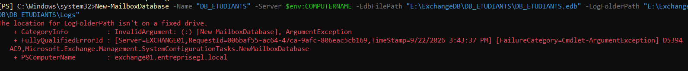

L'erreur se produit parce que la lettre **`E:`** correspond actuellement au lecteur DVD virtuel contenant l'ISO d'Exchange. Idéalement il faut mettre les logs et la base de données sur un autre disque donc on va monter un nouveau disque de 40Go, le formater en NTFS en lui assignant la lettre E: à l’initialisation. Commencons par ejecter l’ISO qui avait été monté sinon la lettre ne sera pas disponible.

### Ajouter et formater un second disque virtuel en E:

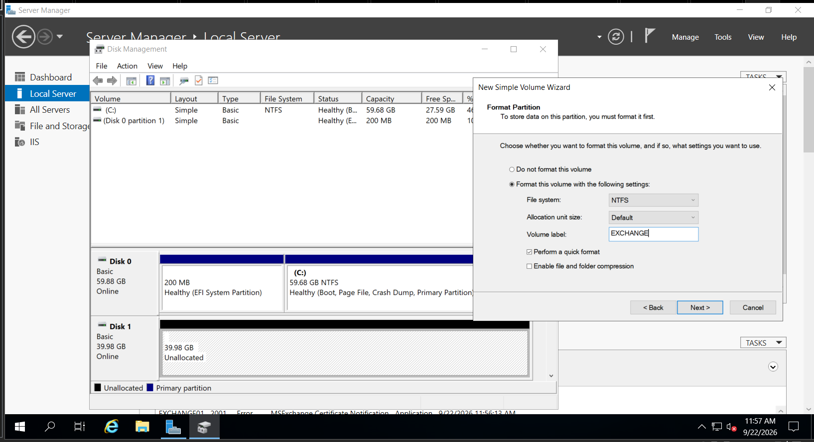

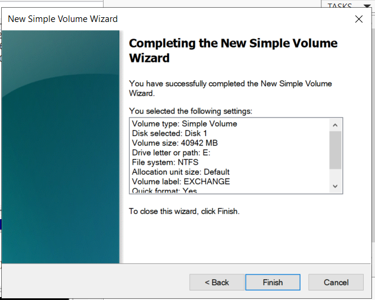

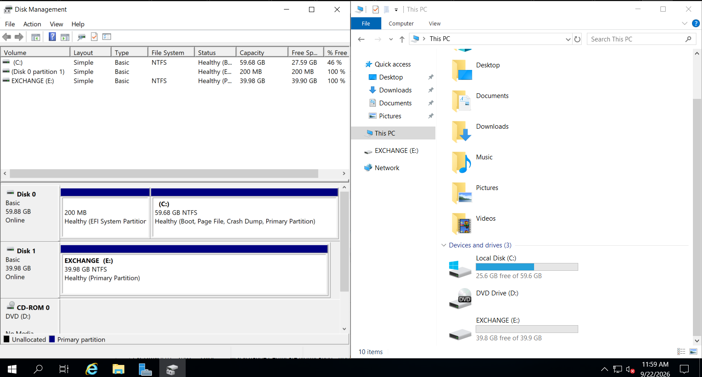

Puis on crée la base de données

</aside>

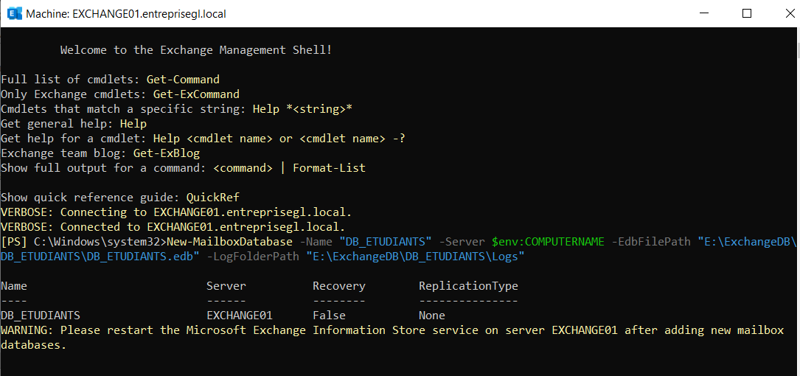

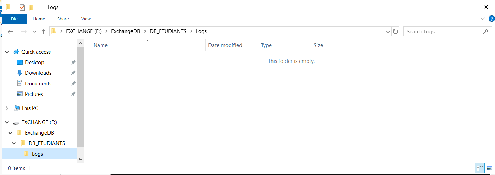

### Monter la base de données

Une base de données doit être montée pour devenir accessible en lecture/écriture :

```powershell
Mount-Database "DB_ETUDIANTS"
```

**`Mount-Database`** : Rend la base de données active et connectée au moteur de stockage ESE (Extensible Storage Engine), permettant la création et l'hébergement des boîtes aux lettres.

## Définir une limite de taille/quota logique de 1.5 Go par boîte aux lettres et Configurer la rétention des éléments supprimés à 12 jours

```powershell
Set-MailboxDatabase "DB_ETUDIANTS" -IssueWarningQuota 1.3GB -ProhibitSendQuota 1.5GB -ProhibitSendReceiveQuota 1.7GB -DeletedItemRetention 12.00:00:00
```

 • **`-IssueWarningQuota 1.3GB`** : Seuil d'avertissement. Lorsque la boîte aux lettres atteint 1,3 Go, un courriel d'alerte système est envoyé à l'utilisateur.   
• **`-ProhibitSendQuota 1.5GB`** : Limite d'envoi (quota demandé de 1.5 Go). L'utilisateur ne peut plus expédier de nouveaux courriels s'il dépasse cette taille.   
• **`-ProhibitSendReceiveQuota 1.7GB`** : Limite stricte d'envoi et de réception. La boîte aux lettres est complètement bloquée pour toute émission ou réception de message.   
• **`-DeletedItemRetention 12.00:00:00`** : Période pendant laquelle un élément mis à la corbeille puis purgé reste récupérable via l'option *Récupérer les éléments supprimés* (ici configuré au format `Jours.Heures:Minutes:Secondes`, soit exactement 12 jours).  

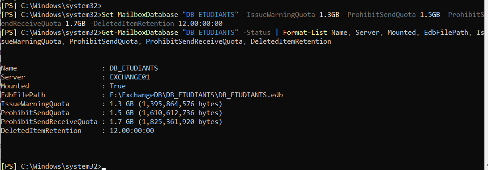

# 5- Création de Boîtes aux Lettres

| Prénom | Nom | Nom d'affichage | Alias | Adresse courriel | Mot de passe | Base de données |
| --- | --- | --- | --- | --- | --- | --- |
| Jean | Dupont | Etudiant1 | etudiant1 | etudiant1@entreprisegl.local | Pa$$w0rd123 | DB_ETUDIANTS |
| Eric | Bass | Etudiant2 | etudiant2 | etudiant2@entreprisegl.local | Pa$$w0rd123 | DB_ETUDIANTS |
| Zach | Myers | Professeur | professeur | professeur@entreprisegl.local | Pa$$w0rd123 | DB_ETUDIANTS |

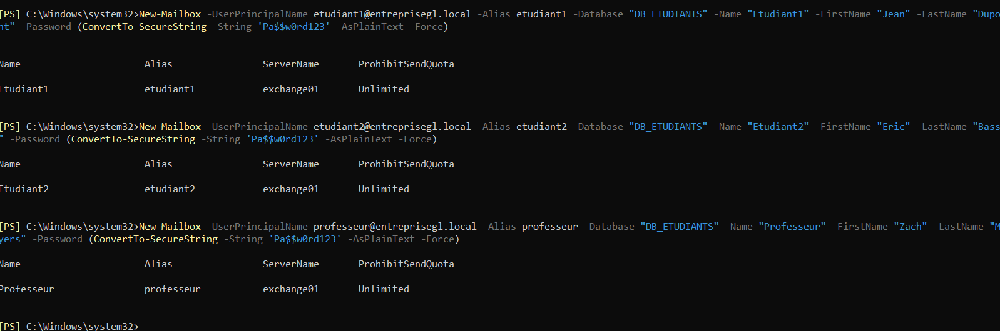

 • **`-UserPrincipalName`** : Identifiant de connexion principal (UPN) au format courriel.   
• **`-Alias`** : Nom court utilisé pour l'adresse de messagerie interne.   
• **`-Database`** : Spécifie la base de données de boîtes aux lettres cible (`DB_ETUDIANTS`).   
• **`-Password`** : Convertit la chaîne brute en objet texte sécurisé requis par Windows pour la création de compte.   

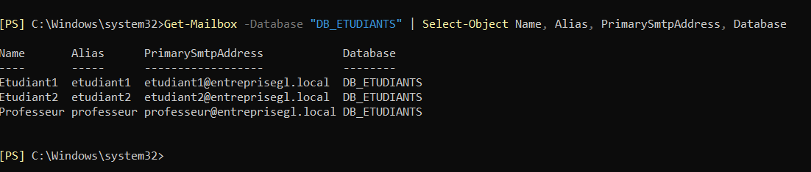

# 6- Gestion des Groupes de Distribution

## Créer le groupe de distribution avec approbation ouverte

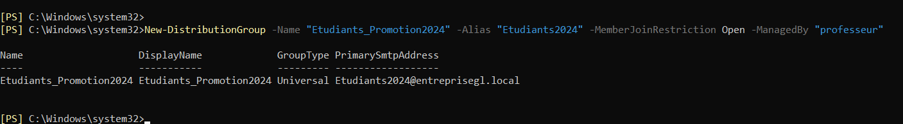

• **`-Name`** : Nom affiché de l'objet groupe dans l'annuaire Active Directory et le carnet d'adresses Exchange.   
• **`-Alias`** : Identifiant textuel court définissant l'adresse SMTP du groupe (`Etudiants2024@entreprisegl.local`).   
• **`-MemberJoinRestriction Open`** : Règle d'adhésion permettant à tout utilisateur de rejoindre le groupe sans approbation préalable d'un modérateur.   
• **`-ManagedBy "professeur"`** : Désigne l'utilisateur propriétaire responsable de l'administration du groupe.   
• **`Add-DistributionGroupMember`** : Associe un objet destinataire existant à la liste de distribution

## Ajouter "etudiant1" et "etudiant2" comme membres du groupe

```powershell
Add-DistributionGroupMember -Identity "Etudiants_Promotion2024" -Member "etudiant1"
Add-DistributionGroupMember -Identity "Etudiants_Promotion2024" -Member "etudiant2"
```

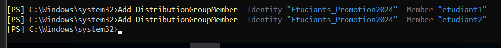

On vérifie 

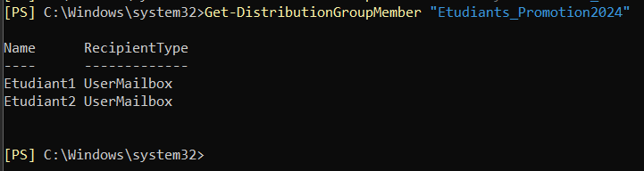

## Tester l’envoi d’un courriel au groupe

```powershell
Send-MailMessage -From "professeur@entreprisegl.local" -To "Etudiants2024@entreprisegl.local" -Subject "Test groupe distribution" -Body "Message de test envoyé à la promotion 2024" -SmtpServer "localhost"
```

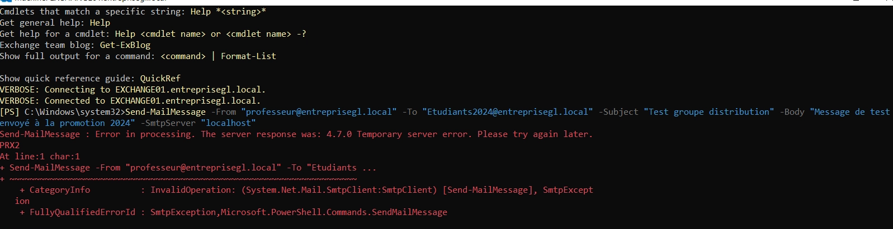

On va rajouter un paramètre -Port

```powershell
Send-MailMessage -From "professeur@entreprisegl.local" -To "Etudiants2024@entreprisegl.local" -Subject "Test groupe distribution" -Body "Message de test envoyé à la promotion 2024" -SmtpServer "127.0.0.1" -Port 2525
```

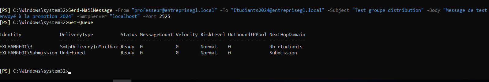

• **`-From`** : Identifie l'expéditeur 
• **`-To`** : Cible la liste de distribution
• **`-Subject` / `-Body`** : Définissent respectivement le titre et le contenu du courriel.
• **`-SmtpServer "localhost"`** : Envoie le flux vers la machine locale via l'adresse de bouclage (*loopback*).
• **`-Port 2525`** : Vise directement le connecteur de transport interne (*Backend Transport*) d'Exchange, évitant ainsi le proxy frontal (*Frontend*) du port 25.

# 7- Création de Salles de Réunion

## Créer une boîte aux lettres de type Salle de réunion nommée "Salle_Formation_GL".

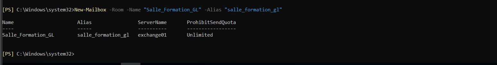

**`-Room`** : Indique à Exchange de créer une ressource de type salle (emplacement physique réservable) au lieu d'une boîte aux lettres utilisateur

## Configurer l'acceptation automatique et les heures ouvrables

```powershell
Set-CalendarProcessing -Identity "Salle_Formation_GL" -AutomateProcessing AutoAccept -ScheduleOnlyDuringWorkHours $true
```

**`-AutomateProcessing AutoAccept`** : Active l'assistant de réservation automatique  qui accepte directement les invitations si le créneau est libre et les refuse s'il y a un conflit, sans intervention humaine.   
**`-ScheduleOnlyDuringWorkHours $true`** : Bloque automatiquement toute tentative de réservation en dehors des plages d'heures de travail configurées.   

## Vérifier la configuration et prendre la capture

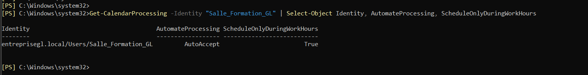

# 8- Configuration Outlook

## Configurer un profil Outlook pour l'utilisateur `etudiant1`.

**Joindre le WinClient au domaine**


**Installer Outlook**


<aside>
⚙

Troubleshooting

**Configurer Outlook en mode natif Exchange** 
En environnement d'entreprise, on ne configure jamais un compte Exchange interne en IMAP (qui désactive les calendriers partagés, les contacts synchronisés et les fonctions avancées).
Pour configurer le compte en mode **Exchange natif** :
Panneau de configuration sur `WinClient`puis Mail (Microsoft Outlook) 


Le certificat auto-signé d'Exchange n'est pas approuvé par la machine cliente).   
Tant que ce certificat n'est pas installé dans le magasin des autorités de confiance de **WinClient**, Outlook refusera d'établir la connexion sécurisée.Etant donné qu’on n’a pas encore de certificat propre a notre entreprise, nous allons installer ce certificat sur la machine 


</aside>

On est connecte avec etudiant1


## Tester l'envoi d'un courriel entre `etudiant1` et `etudiant2`.


## Vérifier la réception du message dans la boîte de réception

On va se connecter sur le client en tant qu’etudiant2 et vérifier qu’il a bien recu le message 

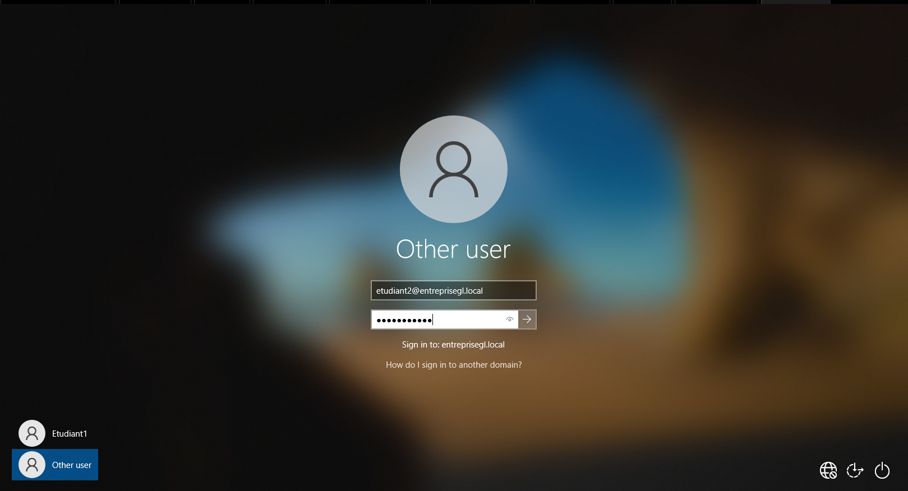

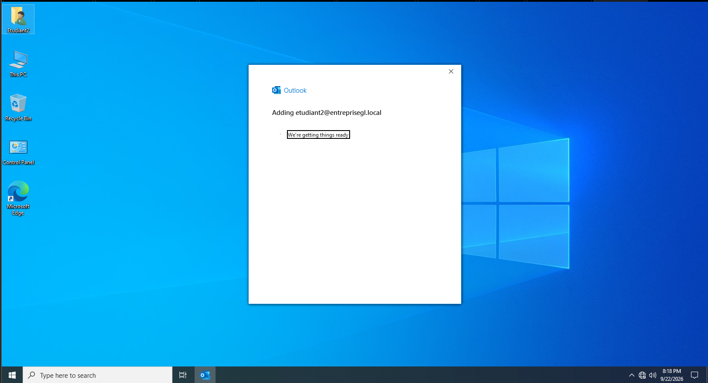

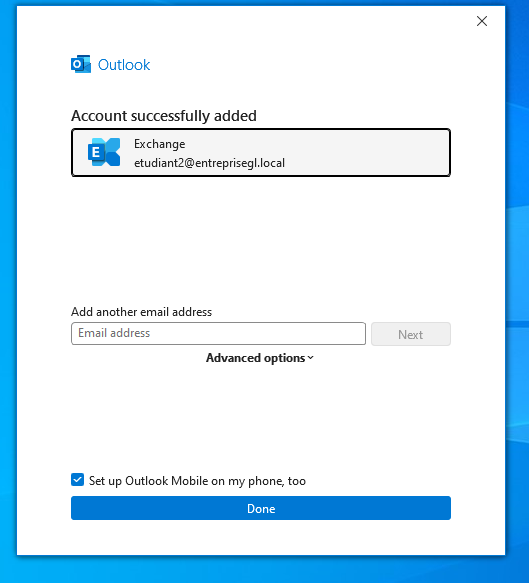

L’inbox est vide 

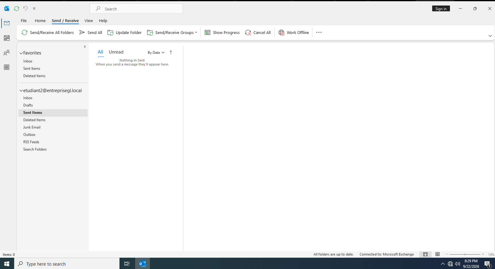

<aside>
⚙

Troubleshooting

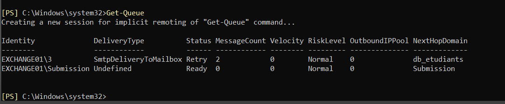

```powershell
Get-MessageTrackingLog -Sender etudiant1@entreprisegl.local -Recipients etudiant2@entreprisegl.local -Start (Get-Date).AddMinutes(-10) | Format-List
```

Le principe : l'erreur "451 4.4.0 DNS query failed" survient  parce que le serveur DNS utilisé par Exchange Server ne fonctionne pas correctement car par défaut, Exchange utilise les paramètres DNS de la carte réseau pour le routage du courrier sortant. Cependant nous avons deux cartes, chacune avec un DNS

```powershell
Get-TransportService -Identity EXCHANGE01 | Format-List *DNS*
ExternalDNSAdapterEnabled : True
ExternalDNSAdapterGuid    : 00000000-0000-0000-0000-000000000000
ExternalDNSProtocolOption : Any
ExternalDNSServers        : {}
InternalDNSAdapterEnabled : True
InternalDNSAdapterGuid    : 00000000-0000-0000-0000-000000000000
InternalDNSProtocolOption : Any
InternalDNSServers        : {}
DnsLogMaxAge              : 7.00:00:00
DnsLogMaxDirectorySize    : 100 MB (104,857,600 bytes)
DnsLogMaxFileSize         : 10 MB (10,485,760 bytes)
DnsLogPath                :
DnsLogEnabled             : False
```

InternalDNSServers et ExternalDNSSErvers sont vides donc la machine utilise les deux DNS pour les resolutions internes. Il faut donc fixer le DNS interne

```powershell
Set-TransportService -Identity EXCHANGE01 -InternalDNSAdapterEnabled $false -InternalDNSServers 192.168.100.135
```

Puis : 

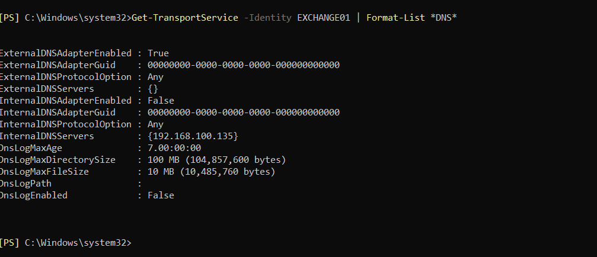

On redemarre les services 

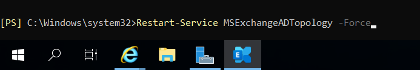

</aside>

Entre temps j’ai envoyé d’autre messages pendant le troublshooting ce qui explique le nombre de message recu

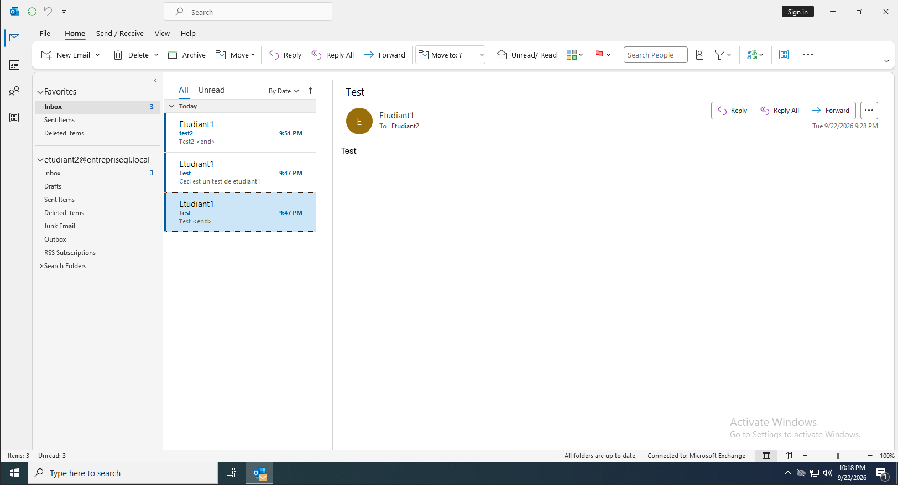

# 9- Accès Web (OWA)

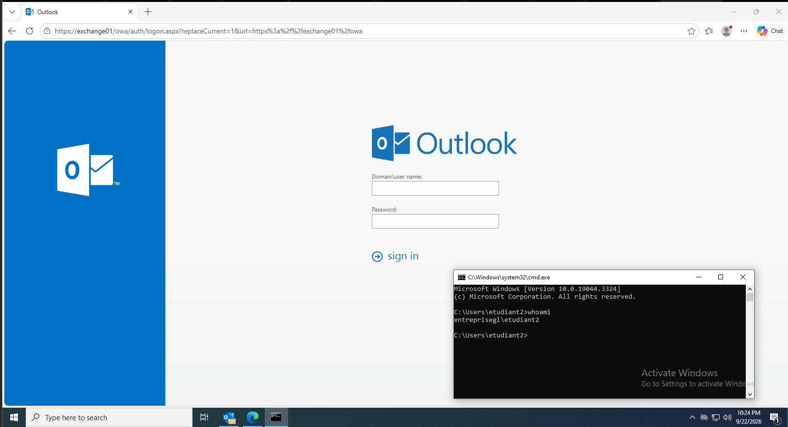

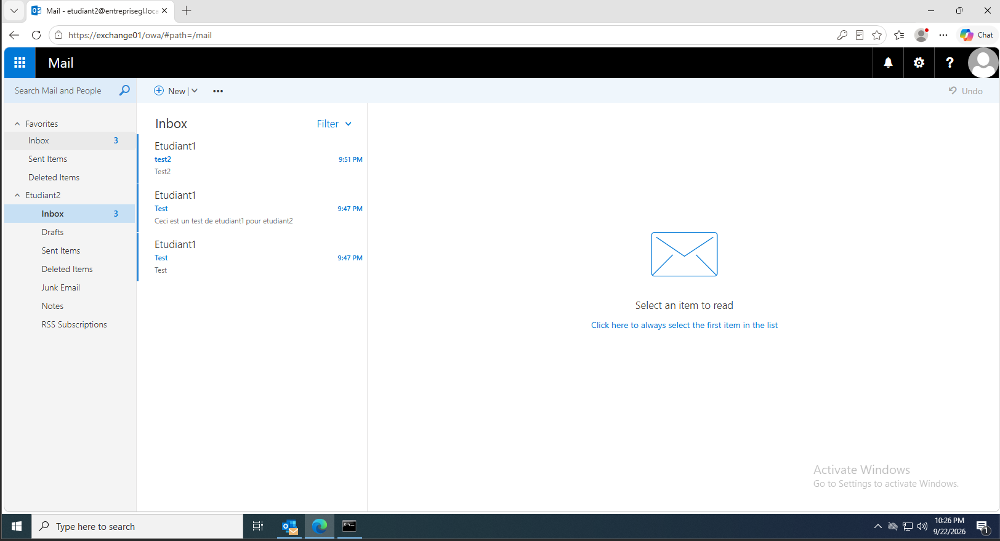

**Envoyer un courriel avec une pièce jointe (1 Mo maximum)**

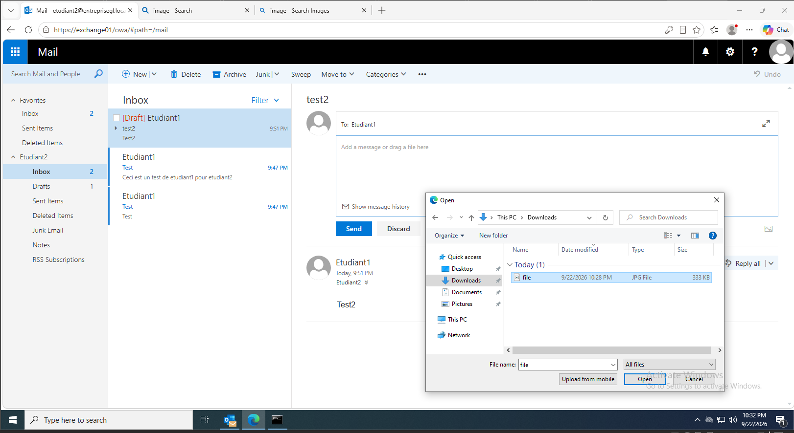

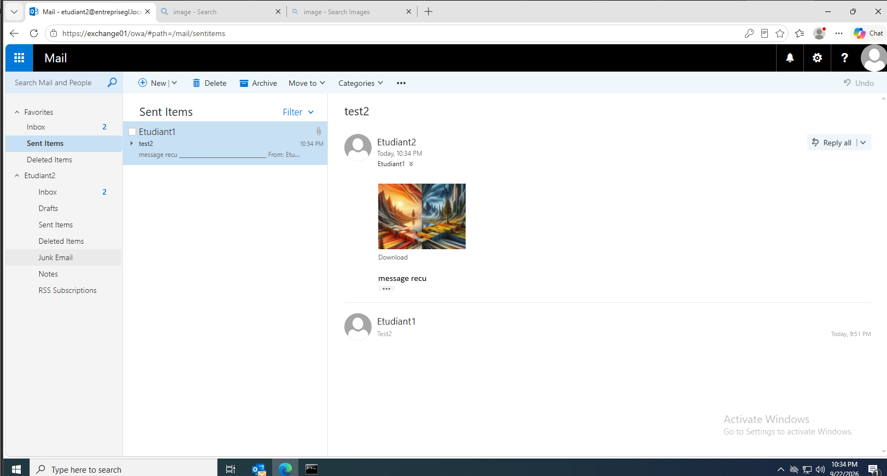

Je me connecte etudiant1 pour voir si je peux télécharger le fichier

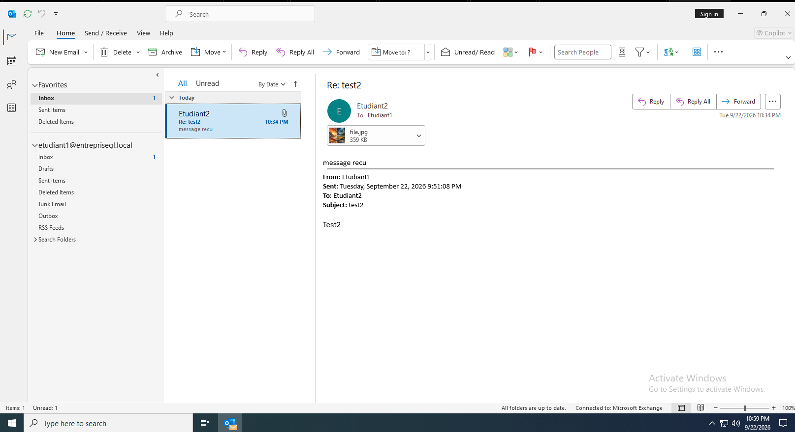

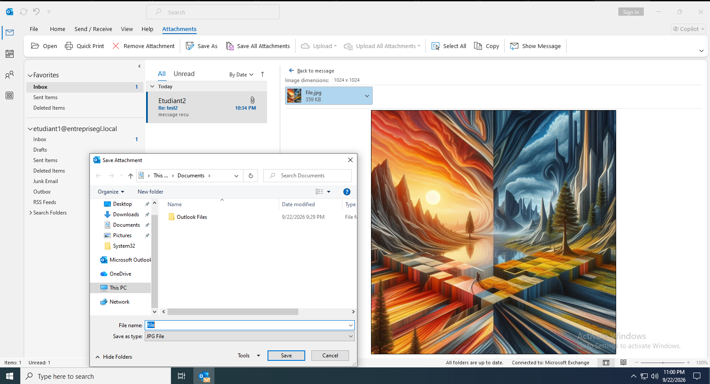

# 10- Surveillance des Services

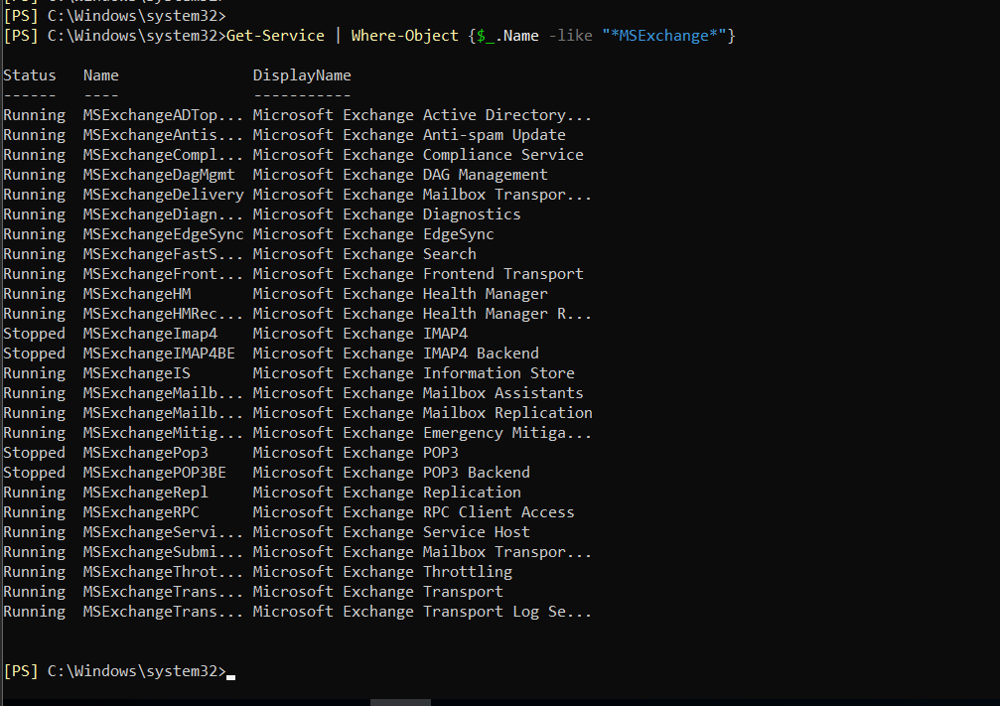

Les 4 services qui sont à l’état Stopped sont des protocoles plus anciens, avec une authentification souvent moins sécurisée, et la plupart des déploiements modernes utilisent uniquement MAPI/HTTP (Outlook), Exchange ActiveSync (mobile) ou OWA (webmail). Ils ne démarrent que si un administrateur les active explicitement.

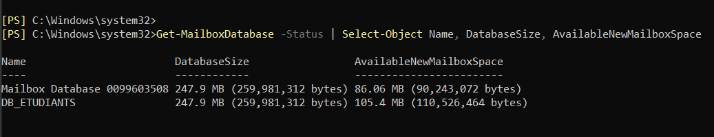

Nous avons les deux bases ; celle par défaut créée à l’installation et celle que j’ai créé avec 247.9 MB utilisés et encore105 MB d'espace disponible pour de nouvelles boîtes


Pas de message bloqués ou en attente. Le statut est Ready. Tout est bon
